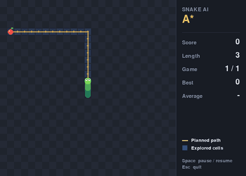
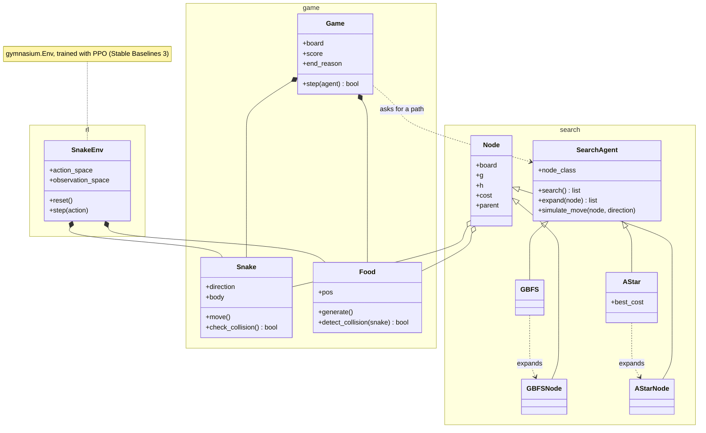

# Snake: Intelligent Agents

[](https://github.com/Cristianperezd/TFG-Snake/actions/workflows/tests.yml)
[](pyproject.toml)
[](LICENSE.txt)
[](https://github.com/astral-sh/ruff)

Bachelor's Thesis (TFG) in Computer Engineering, Universitat Autònoma de Barcelona, 2023.

A Snake game built from scratch with **Pygame**, used as a testbed to compare classic search agents (**Greedy Best-First Search** and **A\***) with a **reinforcement learning** agent (**PPO**, via Stable Baselines 3 on a custom Gymnasium environment).

<p align="center">
  
</p>

> **Status:** this repository is being revisited. The original thesis submission is preserved as [`v1.0.0`](../../tree/v1.0.0). The current work reviews what I built at the time and improves it step by step:
>
> - **1.x**: the thesis project, cleaned up and made reproducible. Results match the thesis.
> - **2.x**: improvements beyond the thesis.
>
> See the [changelog](CHANGELOG.md) for details.

## Results

Each agent played 50 games on a 25×25 board. The score is the number of apples eaten. The thesis reports a limit of 2,000 expanded nodes per search; in the code, only GBFS enforces it, while the final A\* searches until it finds a path or runs out of options.

| Agent | Mean score | Min – Max |
|---|---:|---:|
| **A\*** | **78.34** | 36 – 136 |
| GBFS | 42.94 | 23 – 72 |
| PPO, v2 (cumulative reward) | 20.90 | 3 – 42 |
| PPO, v1 (constant reward) | 11.54 | 1 – 33 |

Key takeaways:

- **A\* almost doubles GBFS.** The accumulated path cost, together with pruning of redundant paths, keeps A\* from getting lost before it reaches the node limit. Both agents can still die when an apple spawns in a position with no safe path.
- **Reward design mattered more than the algorithm.** With a constant +10 / −10 reward, PPO learned to eat once and then circle forever. Switching to a cumulative reward for each apple doubled the mean score.
- **RL did not beat search here.** The PPO agent sees a compact 9-value observation: relative food direction, current action, and whether each neighbouring cell is safe. It has no information about its own body beyond one step away, so it cannot plan long paths the way A\* does.

The full write-up (in Catalan) is available from the UAB repository: [Snake: Implementació d'agents intel·ligents](https://ddd.uab.cat/record/280737) ([PDF](https://ddd.uab.cat/pub/tfg/2022/tfg_1634657/Informe_Final_TFG.pdf)).

## How it works

**Game.** `Snake`, `Food` and `Game` implement the rules on a 500×500 px window with 20 px cells. `Game` keeps a 25×25 matrix of the board (empty / snake / food) so the agents can read the state.

**Search agents.** Each search runs from the current state to the next apple. It simulates moves on copies of the snake and returns the path, which the game then follows.

- `Node` stores the board, snake, food, the Manhattan-distance heuristic `h` and the path cost `g`.
- `GBFSNode` orders nodes by `h` only. `AStarNode` orders them by `g + h`.
- `SearchAgent` holds the logic shared by both agents: move simulation, collision checks and path reconstruction.
- `AStar` also keeps the lowest cost that has reached each cell, and discards children that reach a cell with an equal or higher cost. This prunes redundant paths.

**Reinforcement learning.** `SnakeEnv` wraps the game as a Gymnasium environment:

- 4 discrete actions (up, down, left, right).
- A 9-value observation: food left/right/up/down, the last action, and whether moving up/down/left/right is safe.
- Reward of +10 for each apple, accumulated over the episode, and −10 on death.

PPO is trained with Stable Baselines 3 (`MlpPolicy`).

### Architecture

The code is a Python package, `snake_ai`, with three subpackages: `game`, `search` and `rl`. The command-line interface (`snake_ai.cli`) plays games with `Game` and a search agent (`snake-ai play`), or trains and evaluates PPO on `SnakeEnv` (`snake-ai train`, `snake-ai evaluate`).



The original class diagram from the thesis (PlantUML) is available at [`v1.0.0`](../../tree/v1.0.0/Documentation).

## Running it

Requires Python 3.10+.

```bash
python -m venv .venv
# Windows: .venv\Scripts\activate    Linux/macOS: source .venv/bin/activate
pip install -e .          # the game and the search agents
pip install -e ".[rl]"    # also PPO training and evaluation (Stable Baselines 3, PyTorch, TensorBoard)
```

This installs the `snake-ai` command. `python -m snake_ai` does the same, and `snake-ai --version` prints the installed version.

### Search agents and manual play

`snake-ai play` runs the game. By default the A\* agent plays one game in a window at 30 FPS.

| Command | What it does |
|---|---|
| `snake-ai play` | The A\* agent plays one game. |
| `snake-ai play --agent gbfs --games 5` | The GBFS agent plays five games in a row. |
| `snake-ai play --agent human` | You play with the arrow keys. |
| `snake-ai play --games 50 --headless` | Runs the thesis evaluation: 50 games without a window, as fast as possible. The thesis runs were not seeded, so the exact scores vary from run to run. |
| `snake-ai play --games 50 --headless --seed 1` | The same, with fixed food positions, so the run can be repeated exactly. |

| Option | Default | Description |
|---|---|---|
| `--agent {human,gbfs,astar}` | `astar` | Who plays. |
| `--games N` | `1` | Number of games. The thesis results use 50. |
| `--fps N` | `30` | Frame rate of the window (`0` = no limit). |
| `--seed N` | none | Random seed for the food positions. |
| `--headless` | off | No window and no frame limit, for fast evaluation. Not available for `human`. |
| `--max-steps N` | none | Stop a game after N frames. |

After each game it prints the score and why the game ended (`collision`, `no path` when the agent cannot reach the food, or `step limit`), and at the end the mean, min and max scores. Closing the window stops the run.

### PPO

Training and evaluation need Stable Baselines 3 (PyTorch) and TensorBoard: install the `rl` extra (`pip install -e ".[rl]"`).

| Command | What it does |
|---|---|
| `snake-ai train` | Trains a PPO agent for ~5M steps, as in the thesis. Checkpoints go to `models/<run>/` every 10,000 steps and TensorBoard logs to `logs/<run>/`. |
| `snake-ai train --timesteps 200000 --run-name quick --seed 0` | A shorter, seeded run in `models/quick/`. |
| `snake-ai evaluate models/quick/200000.zip` | Plays 50 episodes with a checkpoint in a window and prints score statistics. |
| `snake-ai evaluate models/quick/200000.zip --episodes 10 --no-render --max-steps 5000` | The same without a window, stopping episodes that run too long. |

`snake-ai train` options: `--timesteps`, `--checkpoint-freq`, `--run-name`, `--models-dir`, `--logs-dir`, `--seed`. `snake-ai evaluate` options: `--episodes`, `--render` / `--no-render`, `--seed`, `--max-steps`. Run any command with `--help` for details.

Trained models are not included in the repository.

## Tests

```bash
pip install -e ".[test]"   # no PyTorch needed
pytest
ruff check && ruff format --check
```

- **Regression tests** replay A\* games, GBFS searches and RL environment episodes with fixed random seeds, and compare them frame by frame with traces recorded from the original thesis code (`tests/golden/`, generated at `v1.1.0`). Any change to the agents' behaviour makes them fail.
- **Unit tests** cover movement, collisions, food respawning, path validity, the environment's observations and rewards, how games end, the command-line options and the `snake-ai` entry point.

They run automatically on every push and pull request with GitHub Actions, on Python 3.10 to 3.13, together with [Ruff](https://github.com/astral-sh/ruff) for linting and formatting (configured in `pyproject.toml`).

## Project structure

```
├── snake_ai/
│   ├── cli.py              # snake-ai command: play, train, evaluate
│   ├── __main__.py         # python -m snake_ai
│   ├── game/
│   │   ├── game.py         # Game loop, rendering and board matrix
│   │   ├── snake.py, food.py
│   │   ├── constants.py    # Board geometry and defaults (FPS, node limit)
│   │   └── colors.py       # Colour palette
│   ├── search/
│   │   ├── node.py         # Search node (heuristic + path cost)
│   │   ├── search_agent.py # Logic shared by the search agents
│   │   ├── gbfs.py         # GBFS and GBFSNode
│   │   └── astar.py        # A* and AStarNode
│   └── rl/
│       ├── snake_env.py    # Gymnasium environment
│       ├── train.py        # PPO training
│       └── evaluate.py     # PPO evaluation
├── tests/                  # Regression and unit tests
├── docs/                   # Images for this README
└── pyproject.toml          # Package metadata, dependencies, pytest and Ruff settings
```

## Tech stack

Python · Pygame · NumPy · Gymnasium · Stable Baselines 3 (PPO)

## License

[MIT](LICENSE.txt)
