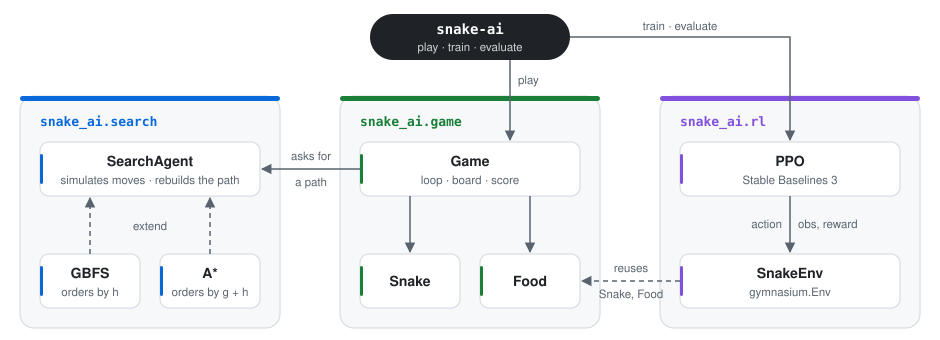
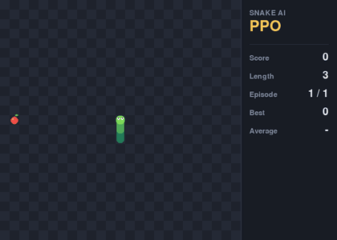

# Snake: Intelligent Agents

[](https://github.com/Cristianperezd/TFG-Snake/actions/workflows/tests.yml)
[](pyproject.toml)
[](LICENSE.txt)
[](https://github.com/astral-sh/ruff)
[](https://cristianperezd.github.io/TFG-Snake/)

Bachelor's Thesis (TFG) in Computer Engineering, Universitat Autònoma de Barcelona, 2023.

A Snake game built from scratch with **Pygame**, used as a testbed to compare classic search agents (**Greedy Best-First Search** and **A\***) with a **reinforcement learning** agent (**PPO**, via Stable Baselines 3 on a custom Gymnasium environment).

### [▶ Play in the browser](https://cristianperezd.github.io/TFG-Snake/)

Play it yourself or watch A\* and GBFS play, with their planned path on the board, without installing anything. The first load downloads the Python runtime (a few MB). The PPO agent is not available there: it needs PyTorch, which does not run in the browser ([details](#in-the-browser)).

<p align="center">
  
</p>

> **Status:** this repository is being revisited. The original thesis submission is preserved as [`v1.0.0`](../../tree/v1.0.0). The current work reviews what I built at the time and improves it step by step:
>
> - **1.x**: the thesis project, cleaned up and made reproducible. Results match the thesis.
> - **2.x**: improvements beyond the thesis.
>
> See the [changelog](CHANGELOG.md) for details.

## Results

Each agent played 50 games on a 25×25 board. The score is the number of apples eaten. The thesis reports a limit of 2,000 expanded nodes per search; in the code, only GBFS enforces it, while the final A\* searches until it finds a path or runs out of options.

| Agent | Mean score | Min – Max |
|---|---:|---:|
| **A\*** | **78.34** | 36 – 136 |
| GBFS | 42.94 | 23 – 72 |
| PPO, v2 (cumulative reward) | 20.90 | 3 – 42 |
| PPO, v1 (constant reward) | 11.54 | 1 – 33 |

Key takeaways:

- **A\* almost doubles GBFS.** The accumulated path cost, together with pruning of redundant paths, keeps A\* from getting lost before it reaches the node limit. Both agents can still die when an apple spawns in a position with no safe path.
- **Reward design mattered more than the algorithm.** With a constant +10 / −10 reward, PPO learned to eat once and then circle forever. Switching to a cumulative reward for each apple doubled the mean score.
- **RL did not beat search here.** The PPO agent sees a compact 9-value observation: relative food direction, current action, and whether each neighbouring cell is safe. It has no information about its own body beyond one step away, so it cannot plan long paths the way A\* does.

The full write-up (in Catalan) is available from the UAB repository: [Snake: Implementació d'agents intel·ligents](https://ddd.uab.cat/record/280737) ([PDF](https://ddd.uab.cat/pub/tfg/2022/tfg_1634657/Informe_Final_TFG.pdf)).

## How it works

**Game.** `Snake`, `Food` and `Game` implement the rules on a 500×500 px board with 20 px cells. `Game` keeps a 25×25 matrix of the board (empty / snake / food) so the agents can read the state. Drawing lives in `render.py`, shared by the game window and the RL environment: it only reads the state, so it never changes a game.

**Search agents.** Each search runs from the current state to the next apple. It simulates moves on copies of the snake and returns the path, which the game then follows.

- `Node` stores the board, snake, food, the Manhattan-distance heuristic `h` and the path cost `g`.
- `GBFSNode` orders nodes by `h` only. `AStarNode` orders them by `g + h`.
- `SearchAgent` holds the logic shared by both agents: move simulation, collision checks and path reconstruction.
- `AStar` also keeps the lowest cost that has reached each cell, and discards children that reach a cell with an equal or higher cost. This prunes redundant paths.

**Reinforcement learning.** `SnakeEnv` wraps the game as a Gymnasium environment:

- 4 discrete actions (up, down, left, right).
- A 9-value observation: food left/right/up/down, the last action, and whether moving up/down/left/right is safe.
- Reward of +10 for each apple, accumulated over the episode, and −10 on death.

PPO is trained with Stable Baselines 3 (`MlpPolicy`).

### Architecture

The code is a Python package, `snake_ai`, with three subpackages: `game`, `search` and `rl`. The command-line interface (`snake_ai.cli`) plays games with `Game` and a search agent (`snake-ai play`), or trains and evaluates PPO on `SnakeEnv` (`snake-ai train`, `snake-ai evaluate`).

<p align="center">
  <picture>
    <source media="(prefers-color-scheme: dark)" srcset="docs/architecture-dark.svg">
    
  </picture>
</p>

The original class diagram from the thesis (PlantUML) is available at [`v1.0.0`](../../tree/v1.0.0/Documentation).

## Running it

Requires Python 3.10+.

```bash
python -m venv .venv
# Windows: .venv\Scripts\activate    Linux/macOS: source .venv/bin/activate
pip install -e .          # the game and the search agents
pip install -e ".[rl]"    # also PPO training and evaluation (Stable Baselines 3, PyTorch, TensorBoard)
pip install -e ".[record]"  # also recording games as GIFs (Pillow)
```

This installs the `snake-ai` command. `python -m snake_ai` does the same, and `snake-ai --version` prints the installed version.

### Search agents and manual play

`snake-ai play` runs the game. By default the A\* agent plays one game in a window at 30 FPS. A side panel shows the agent, score, length, game number, best score, average so far and FPS.

| Command | What it does |
|---|---|
| `snake-ai play` | The A\* agent plays one game. |
| `snake-ai play --agent gbfs --games 5` | The GBFS agent plays five games in a row. |
| `snake-ai play --agent human` | You play with the arrow keys. |
| `snake-ai play --games 50 --headless` | Runs the thesis evaluation: 50 games without a window, as fast as possible. The thesis runs were not seeded, so the exact scores vary from run to run. |
| `snake-ai play --games 50 --headless --seed 1` | The same, with fixed food positions, so the run can be repeated exactly. |
| `snake-ai play --show-path` | Also draws the path the agent plans to the apple and, lightly, the cells its search explored. |
| `snake-ai play --headless --seed 1 --max-steps 750 --show-path --record demo.gif --record-every 2 --record-scale 0.6` | Saves a game as a GIF without opening a window (how `docs/astar-demo.gif` was made; needs the `record` extra). |

| Option | Default | Description |
|---|---|---|
| `--agent {human,gbfs,astar}` | `astar` | Who plays. |
| `--games N` | `1` | Number of games. The thesis results use 50. |
| `--fps N` | `30` | Frame rate of the window (`0` = no limit). |
| `--seed N` | none | Random seed for the food positions. |
| `--headless` | off | No window and no frame limit, for fast evaluation. Not available for `human`. |
| `--max-steps N` | none | Stop a game after N frames. |
| `--show-path` | off | Draw the search agent's planned path and explored cells. Not available for `human`. |
| `--game-over-delay S` | `1.5` | Seconds the game-over message stays on screen between games. Skipped with `--headless` or `--fps 0`. |
| `--record PATH` | none | Save the run as an animated GIF (`record` extra). Works with `--headless`. |
| `--record-every N`, `--record-scale F` | `1`, `1.0` | Keep one frame in N and resize the frames, for smaller GIFs. |

After each game it prints the score and why the game ended (`collision`, `no path` when the agent cannot reach the food, or `step limit`), and at the end the mean, min and max scores. In the window, **Space** pauses and resumes, and **Esc** or closing the window stops the run. None of this changes the games: a run with a window, `--show-path` or `--record` gives the same scores as `--headless`.

### In the browser

The [browser version](https://cristianperezd.github.io/TFG-Snake/) runs the same `snake_ai` code compiled to WebAssembly with [pygbag](https://github.com/pygame-web/pygbag): the same game, agents and drawing as `snake-ai play`. It is controlled with the keyboard:

| Key | Action |
|---|---|
| **1** / **2** / **3** | In the menu: play yourself, or let A\* or GBFS play |
| Arrow keys | Steer the snake (Human) |
| **P** | Show or hide the search agent's planned path and explored cells |
| **+** / **-** | Faster / slower (Human starts at 10 frames per second, the agents at 30) |
| **Space** | Pause and resume |
| **R** | Start a new game |
| **M** or **Esc** | Back to the menu |
| **Enter** | Next game after a game over (the agents go on by themselves) |

The side panel keeps the score, best score and average over the games played. There is no PPO agent: it needs PyTorch (through Stable Baselines 3), which has no WebAssembly build, so `snake_ai.rl` is not included.

The page is built and published to GitHub Pages by [`.github/workflows/pages.yml`](.github/workflows/pages.yml) on every push to `main`. To build and try it locally:

```bash
pip install pygbag==0.9.3
python web/build.py --serve       # then open http://localhost:8000
```

`web/main.py` is the page's program and `snake_ai/browser.py` its menu and game loop. The browser needs a loop that never blocks, so it uses `Game.advance`, the part of `Game.step` that plays one frame without reading events or waiting; the games are the same frame by frame (a test checks it against the regression traces).

### PPO

Training and evaluation need Stable Baselines 3 (PyTorch) and TensorBoard: install the `rl` extra (`pip install -e ".[rl]"`).

**Try the pretrained agent.** A PPO agent trained with the thesis configuration ships with the package (`snake_ai/rl/pretrained/ppo_snake.zip`, ~150 KB), so this is enough:

```bash
pip install -e ".[rl]"
snake-ai evaluate                                    # 50 episodes in a window
snake-ai evaluate --episodes 50 --no-render --seed 0 # the evaluation below, without a window
```

<p align="center">
  
</p>

**Train your own.**

| Command | What it does |
|---|---|
| `snake-ai train` | Trains a PPO agent for ~5M steps, as in the thesis. Checkpoints go to `models/<run>/` every 10,000 steps and TensorBoard logs to `logs/<run>/`. |
| `snake-ai train --timesteps 200000 --run-name quick --seed 0` | A shorter, seeded run in `models/quick/`. |
| `snake-ai evaluate models/quick/200000.zip` | Plays 50 episodes with a checkpoint in a window and prints score statistics. |
| `snake-ai evaluate models/quick/200000.zip --episodes 10 --no-render --max-steps 5000` | The same without a window, truncating episodes that run too long. |

`snake-ai train` options: `--timesteps`, `--checkpoint-freq`, `--run-name`, `--models-dir`, `--logs-dir`, `--seed`. `snake-ai evaluate` options: `MODEL` (default: the pretrained agent), `--episodes`, `--render` / `--no-render`, `--seed`, `--max-steps`, `--game-over-delay`, and `--record PATH` (with `--record-every`, `--record-scale`), which also works with `--no-render`: `snake-ai evaluate --episodes 1 --no-render --seed 0 --record ppo.gif --record-every 3 --record-scale 0.6` made the GIF above. The window has the same keys as `snake-ai play`. Run any command with `--help` for details.

Known quirk (kept in 1.x): training saves a checkpoint every `--checkpoint-freq` steps by calling PPO in chunks, and PPO always collects whole rollouts of 2,048 steps. Each 10,000-step chunk therefore runs 10,240 steps, and the default run does 5,109,760 steps instead of 4,990,000. The checkpoint names use the nominal counts.

**Results of the pretrained agent.** The shipped model is the final checkpoint of one run of `snake-ai train --seed 0` (5,109,760 steps, Stable Baselines 3 2.9.2, PyTorch 2.15 on CPU, 1 h 47 min). It was not picked among several runs or checkpoints. 50 episodes per evaluation seed, with `snake-ai evaluate --episodes 50 --no-render --seed N`:

| Agent | Mean, seed 0 | Mean, seed 1 | Mean, seed 2 | All 150 episodes: mean (min – max) |
|---|---:|---:|---:|---:|
| Pretrained agent, final checkpoint (~5.1M steps) | 34.52 | 32.72 | 35.06 | **34.10** (1 – 70) |
| Same run, `990000.zip` checkpoint (~1M steps) | 21.38 | 22.36 | 23.42 | 22.39 (1 – 59) |
| Thesis, PPO v2 (unseeded, 50 episodes) | | | | 20.90 (3 – 42) |

The final checkpoint scores clearly higher than the thesis. A likely reason: the thesis evaluation script (`load_models.py` at [`v1.0.0`](../../tree/v1.0.0)) loaded the `990000.zip` checkpoint of its runs (all its model paths point to that file), not the last one, and the same checkpoint of this run scores 22.39, close to the thesis' 20.90. The rest of the gap can come from the random seeds (the thesis runs were not seeded) and newer library versions. The agent is still far below A\* (78.34): its 9-value observation only says whether the next cell in each direction is safe, so it cannot plan around its own body.

**The environment.** `SnakeEnv` follows the Gymnasium API (`gymnasium.utils.env_checker.check_env` passes) and is registered as `SnakeAI-v0`:

```python
import gymnasium as gym
import snake_ai.rl  # registers SnakeAI-v0

env = gym.make("SnakeAI-v0", render_mode="rgb_array")
obs, info = env.reset(seed=0)
obs, reward, terminated, truncated, info = env.step(env.action_space.sample())
frame = env.render()  # 500x500x3 uint8 array of the board, no window needed
```

- `render_mode`: `None` (default, no drawing), `"human"` (a window, updated every step) or `"rgb_array"` (`render()` returns the frame).
- `max_episode_steps`: truncate episodes after this many steps (`truncated=True`). The default, `None`, never truncates, as in the thesis. `gym.make(..., max_episode_steps=N)` does the same through Gymnasium's `TimeLimit` wrapper.
- Seeding: the food positions use Python's `random` module, as in the thesis. `reset(seed=n)` seeds it, so seeded episodes are reproducible; `reset()` without a seed leaves it untouched, which keeps the thesis behaviour (and the regression tests) unchanged.

## Tests

```bash
pip install -e ".[test,record]"   # no PyTorch needed
pytest
ruff check && ruff format --check
```

- **Regression tests** replay A\* games, GBFS searches and RL environment episodes with fixed random seeds, and compare them frame by frame with traces recorded from the original thesis code (`tests/golden/`, generated at `v1.1.0`). Any change to the agents' behaviour makes them fail.
- **Unit tests** cover movement, collisions, food respawning, path validity, the environment's observations and rewards, its Gymnasium API (`check_env`, seeding, truncation, render modes, `gymnasium.make`), how games end, the command-line options and the `snake-ai` entry point, and the drawing: frames, the search overlay, pause and game-over messages, and GIF recording, including that none of them changes a game. The browser version's menu and game loop are tested without a browser, with simulated key presses. One test plays the pretrained agent; it is skipped when Stable Baselines 3 is not installed, as on CI.

They run automatically on every push and pull request with GitHub Actions, on Python 3.10 to 3.13, together with [Ruff](https://github.com/astral-sh/ruff) for linting and formatting (configured in `pyproject.toml`).

## Project structure

```
├── snake_ai/
│   ├── cli.py              # snake-ai command: play, train, evaluate
│   ├── agents.py           # Who can play: human, GBFS, A*
│   ├── browser.py          # Browser version: menu and non-blocking game loop
│   ├── recording.py        # GIF recording (--record)
│   ├── __main__.py         # python -m snake_ai
│   ├── game/
│   │   ├── game.py         # Game loop and board matrix
│   │   ├── snake.py, food.py
│   │   ├── render.py       # Drawing: board, snake, apple, side panel, overlays
│   │   ├── controls.py     # Window keys: pause, quit
│   │   ├── constants.py    # Board geometry and defaults (FPS, node limit)
│   │   └── colors.py       # Colour palette
│   ├── search/
│   │   ├── node.py         # Search node (heuristic + path cost)
│   │   ├── search_agent.py # Logic shared by the search agents
│   │   ├── gbfs.py         # GBFS and GBFSNode
│   │   └── astar.py        # A* and AStarNode
│   └── rl/
│       ├── snake_env.py    # Gymnasium environment (SnakeAI-v0)
│       ├── train.py        # PPO training
│       ├── evaluate.py     # PPO evaluation
│       └── pretrained/     # The pretrained PPO agent (ppo_snake.zip)
├── web/
│   ├── main.py             # Entry point of the browser version (pygbag)
│   └── build.py            # Builds it with pygbag (--serve to try it locally)
├── tests/                  # Regression and unit tests
├── docs/                   # Images for this README
└── pyproject.toml          # Package metadata, dependencies, pytest and Ruff settings
```

## Tech stack

Python · Pygame · NumPy · Gymnasium · Stable Baselines 3 (PPO) · pygbag (WebAssembly, for the browser version)

## License

[MIT](LICENSE.txt)
